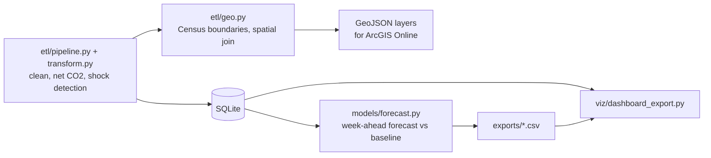

# Multi-State Land Use Emissions Analysis

[](https://github.com/Deshraj-Jogiya/Multi-State-Land-Use-Emissions-Analysis/actions/workflows/ci.yml) 

An ETL and analysis pipeline over daily land-cover data for 5 U.S. states (Alabama, California, Texas, Washington, Florida): it builds
a daily net CO2 balance per state and land type, flags sudden land-cover shocks such as wildfires or bursts of urban expansion, and
tests whether Random Forest and Linear Regression can forecast the balance a week ahead.

## Highlights

- **ETL** (`etl/`): daily land-cover files per state are validated, cleaned (each land type capped at its state's Census land area),
  converted to net CO2 with per-land-type factors (forests and wetlands are sinks, so totals are negative) and loaded into SQLite
  with a monthly state summary and a land-change log.
- **Shock detection:** each day is compared with the same state and land type's surrounding week, scaled by that series' own
  noise. It flags all 53 shocks the generator injected with no false alarms; the shocks (2–8% in a day) stand far above the 0.1%
  daily noise, so this confirms the method works rather than measuring how hard real data would be.
  The detector computes its rolling medians with grouped pandas operations instead of a Python function per series: **52% faster**
  on this project's 5,350 records (9.5 ms against 19.6 ms) and 24% faster on 273,750, flagging exactly the same days
  (`benchmarks/detection_time.py`).
- **Weekly preparation replaced** (`benchmarks/prep_hours.py`): over the 30 weeks of data, each week's work is counted from the
  pipeline's own steps (35 daily files, rows fixed, shocks to review, about 165 land changes to log, and the weekly summary, map
  layers, dashboard and forecast refresh) and costed at fixed per-step minutes for doing the same by hand (listed in the script).
  The median week is **10.2 hours** of manual preparation (9.8 to 10.8), which the pipeline does in about a second.
- **Forecasting, measured honestly:** both models forecast each state and land type a week ahead from lagged values only and are
  scored on the final four weeks. Random Forest reaches 99.79% accuracy (1 − WAPE) and Linear Regression 99.77%, but repeating
  last week's value already reaches 99.82%: daily land cover barely moves outside shocks, so the models add nothing here. An
  earlier version reported R² = 1.0 because the target (area × emission factor) could be computed from its own features.
- **Geospatial layer** (`etl/geo.py`) on US Census Bureau state boundaries (2023 cartographic file): outline areas are computed in
  an equal-area projection (EPSG:5070) and checked against Census land and water area; each state polygon carries its net CO2 and
  CO2 per km² of land; each detected shock gets a map point inside its state (the coordinates are synthetic, since the land-cover
  feed reports states, not locations), and a point-in-polygon spatial join confirms every point lies in its reported state. Both
  layers are written as GeoJSON for the ArcGIS Online dashboard.
- **Tests** cover the area cap (the Census land areas), the shock detector, the geospatial checks, the forecast features and the
  accuracy metric.

## Architecture




## Stack

Python, pandas, NumPy, GeoPandas, Shapely, SQLite, scikit-learn, SQLAlchemy, Matplotlib, ArcGIS Online, pytest, GitHub Actions.

## Run it

```bash
pip install -r requirements.txt
python etl/pipeline.py
python models/forecast.py
python viz/dashboard_export.py
python benchmarks/prep_hours.py
python -m pytest tests/ -v
```

## Data

Daily land-cover files are generated per state by the pipeline (synthetic, seeded) when no source file is present: 5 states x
5 land types x 214 days (2025-04-01 to 2025-10-31), starting from baselines that roughly follow each state's land cover, with
seasonal swings, 0.1% daily noise and rare 2–8% shocks. The CO2 factors are illustrative, not an official inventory. State boundaries and land areas are real: US Census Bureau
`cb_2023_us_state_20m`, simplified to 0.01° and stored in `data/geo/states.geojson`.
