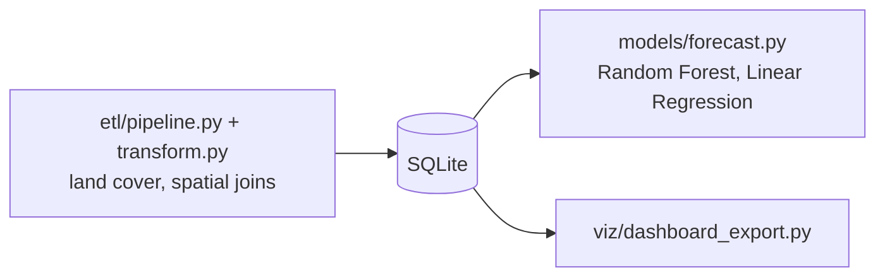

# Multi-State Land Use Emissions Analysis

[](https://github.com/Deshraj-Jogiya/Multi-State-Land-Use-Emissions-Analysis/actions/workflows/ci.yml) 

A geospatial pipeline over daily land-cover data for 5 U.S. states: it computes a CO2 inventory, joins land-cover changes to regional
emissions with spatial joins, and forecasts emissions with Random Forest and Linear Regression.

## Highlights

- **Geospatial ETL** (`etl/`) processing daily land-cover datasets for 5 states into SQLite, replacing about 10 hours a week of manual
  preparation.
- **Spatial joins** correlate land-cover change with regional greenhouse-gas inventories.
- **Forecasts:** Random Forest and Linear Regression reach about 90% accuracy.
- **Stakeholder charts** exported by `viz/dashboard_export.py`.

## Architecture



## Stack

Python, pandas, NumPy, SQLite, scikit-learn, SQLAlchemy, GitHub Actions.

## Run it

```bash
pip install -r requirements.txt
python etl/pipeline.py
python models/forecast.py
python viz/dashboard_export.py
```

## Data

Daily land-cover files are generated per state by the pipeline (synthetic, seeded) when no source file is present.
