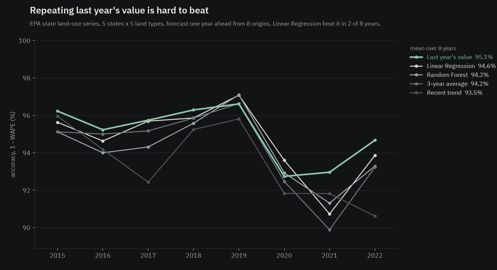

# Findings

Measured results from this repository. Every number below comes from a file in the repository, named under each finding. The daily
land-cover files are simulated (seeded); the EPA state inventory (1990-2022) is real.

## Can a machine-learning model beat "last year's value" on EPA's real land-use flux?

**How it was tested:** the EPA's 25 annual series (5 states x 5 land types) were forecast a year ahead from the three previous years,
trained on years up to 2017 and scored on 2018-2022 (`models/epa_forecast.py`). Accuracy is 1 − WAPE.

| Model | Accuracy (1 − WAPE) |
|---|---|
| Linear Regression | 0.9418 |
| Random Forest | 0.9329 |
| Last year's value | 0.947 |

**Decision:** neither model is presented as a better forecast. Land-use flux changes slowly and the naive baseline wins, so the
README reports the baseline next to the model scores.

**Skills shown:** scikit-learn (LinearRegression, RandomForestRegressor), pandas, time-based holdout, baseline comparison.

**Source:** `exports/epa_forecast_metrics.csv`, `exports/epa_forecast_holdout.csv`, `models/epa_forecast.py`.

## Does that hold from more than one starting year?

**How it was tested:** one split can be luck, so `models/epa_backtest.py` repeats the test from eight forecast origins. For each
target year 2015-2022 the models are trained on every earlier year and forecast that one year for all 25 series. Two more simple
baselines are added: the recent trend (last year plus last year's change) and the 3-year average. Skill is 1 − (model's error /
last year's value's error), so above 0 means better than repeating last year.

| Model | Mean accuracy | Worst year | Best year | Years beating last year's value |
|---|---|---|---|---|
| Last year's value | 0.9506 | 0.9274 | 0.9661 | (reference) |
| Linear Regression | 0.9463 | 0.9073 | 0.9708 | 2 of 8 (2019, 2020) |
| Random Forest | 0.9421 | 0.9131 | 0.9710 | 2 of 8 (2019, 2020) |
| 3-year average | 0.9417 | 0.8989 | 0.9663 | 1 of 8 |
| Recent trend | 0.9349 | 0.9062 | 0.9596 | 0 of 8 |

Last year's value is also the most accurate model on 13 of the 25 series. Its yearly error (WAPE) ran from 3.6% to 7.1% (10th to
90th percentile), the range to expect from a new one-year-ahead forecast.

**Decision:** the result holds across origins: no model is presented as better than last year's value.

**Skills shown:** walk-forward backtesting, baseline skill scores, scikit-learn, pandas, Matplotlib.

**Source:** `exports/epa_backtest_by_year.csv`, `exports/epa_backtest_by_series.csv`, `exports/epa_backtest_summary.csv`,
`models/epa_backtest.py`, `viz/backtest_chart.py`.

## Do the models add anything on the simulated daily balance?

**How it was tested:** a week-ahead forecast from lagged values only, scored on the final four weeks (`models/forecast.py`).

| Model | Forecast accuracy |
|---|---|
| Linear Regression | 0.9981 |
| Random Forest | 0.9983 |
| Same day last week | 0.9984 |

**Decision:** the models add nothing here, because daily land cover barely moves outside shocks. An earlier version reported
R² = 1.0 because the target could be computed from its own features; the features now exclude the same-day area
(`tests/test_pipeline_checks.py::test_forecast_features_exclude_the_same_day_area`).

**Skills shown:** scikit-learn, lag features, target-leakage check, pytest.

**Source:** `exports/forecast_metrics.csv`, `exports/forecast_holdout.csv`, `models/forecast.py`.

## Is the vectorised shock detector faster, and does it flag the same days?

**How it was tested:** the rolling-median detector was timed as a Python function per series and as grouped pandas operations, on
the project's own records and on a 50-state, 3-year version (`benchmarks/detection_time.py`). A test checks that both versions flag
the same days.

| Records | Per series (ms) | Vectorised (ms) | Time saved |
|---|---|---|---|
| 5,350 | 19.6 | 9.5 | 0.5165 |
| 273,750 | 406.1 | 307.6 | 0.2424 |

**Decision:** the grouped pandas version is the one the pipeline uses.

**Skills shown:** pandas groupby rolling windows, benchmarking, equivalence testing.

**Source:** `exports/detection_benchmark.csv`, `benchmarks/detection_time.py`,
`tests/test_pipeline_checks.py::test_vectorised_detector_flags_the_same_days_as_the_per_series_version`.

## Does shock detection find the injected shocks?

**How it was tested:** each day is compared with the same state and land type's surrounding week, scaled by that series' own noise.
The generator injects 2–8% one-day shocks over 0.1% daily noise.

| Result | Value |
|---|---|
| Shocks flagged | 53 (all injected shocks, no false alarms) |
| Texas / California / Florida / Washington / Alabama | 16 / 5 / 6 / 16 / 10 |

**Decision:** the result is reported as a check that the method works, not as a measure of how hard real data would be, since the
shocks stand far above the noise.

**Skills shown:** robust rolling statistics, pandas, GeoJSON export.

**Source:** `outputs/geo/shock_events.geojson` (53 features), `outputs/geo/state_emissions.geojson` (`shocks` per state), `README.md`.

## Does the pipeline's yearly estimate agree with EPA's 2022 inventory?

**How it was tested:** each state's pipeline estimate (area x the state's own EPA emission factor) is compared with EPA's 2022 net
land-use flux in the state map layer (`etl/geo.py`).

| State | EPA 2022 (Tg CO2e) | Pipeline (Tg CO2e/yr) | Difference |
|---|---|---|---|
| Texas | -41.704 | -41.636 | -0.16% |
| California | -32.724 | -32.666 | -0.18% |
| Washington | -18.556 | -18.524 | -0.17% |
| Alabama | -55.07 | -54.996 | -0.13% |
| Florida | -1.648 | -1.712 | 3.9% |

**Decision:** the per-state factors are kept; Florida's larger gap comes from its small net total.

**Skills shown:** GeoPandas, Shapely point-in-polygon join, EPSG:5070 equal-area areas, GeoJSON for ArcGIS Online.

**Source:** `outputs/geo/state_emissions.geojson` (`pipeline_vs_epa_pct`), `etl/geo.py`.

## How much weekly manual preparation does the pipeline replace?

**How it was tested:** each week's work is counted from the pipeline's own steps (files, rows fixed, shocks to review, land changes,
weekly outputs) and costed at the fixed per-step minutes in `MANUAL_MINUTES` (`benchmarks/prep_hours.py`).

| Result | Value |
|---|---|
| Median manual preparation per week (README) | 10.2 hours |
| Lowest and highest week (`exports/prep_hours.csv`) | 9.78 and 10.85 hours |
| Pipeline run per week | about a second |

**Decision:** the weekly preparation runs as the pipeline; the estimate is labelled as costed from fixed per-step minutes.

**Skills shown:** Python benchmarking, ETL step accounting, SQLite.

**Source:** `exports/prep_hours.csv`, `benchmarks/prep_hours.py`, `README.md`.
